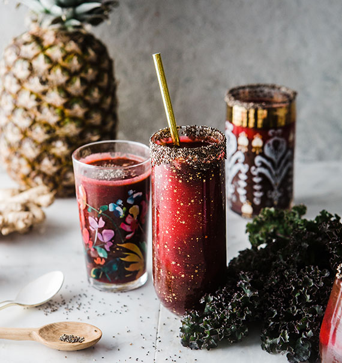

# Search TASK !!!->   https://drive.google.com/file/d/1ARj_3TOYdQ7ZzgjKAfohJwzw-Hbu6FH7/view?usp=sharing
# Revolve Blog

Revolve is a responsive lifestyle and travel blog built with Laravel and Blade. It includes multiple homepage layouts, sidebar options, fashion and lifestyle content sections, an about page, and a contact page.

<p align="center">
  
</p>

## Features

- Six homepage layout variations
- Full-width, left-sidebar, and right-sidebar article layouts
- Fashion category page
- About and contact pages
- Responsive Bootstrap-based design
- Local blog, news, lifestyle, travel, and gallery image assets

## Pages

| Page | Route |
| --- | --- |
| Home | `/` or `/home` |
| About | `/about` |
| Contact | `/contact` |
| Fashion | `/fashion` |
| Full-width layout | `/standard-fullwidth` |
| Left-sidebar layout | `/standard-left-sidebar` |
| Right-sidebar layout | `/standard-right-sidebar` |
| Homepage layout 2 | `/home2` |
| Homepage layout 3 | `/home3` |
| Homepage layout 4 | `/home4` |
| Homepage layout 5 | `/home5` |
| Homepage layout 6 | `/home6` |

## Built With

- Laravel 13
- PHP 8.3+
- Blade templates
- Bootstrap
- Vite
- Tailwind CSS
- SQLite by default

## Getting Started

### Prerequisites

- PHP 8.3 or newer
- Composer
- Node.js and npm
- A local server such as Laragon

### Installation

```bash
git clone https://github.com/Mohamedabolhassen/Revolve-Blog.git
cd Revolve-Blog

composer install
npm install

cp .env.example .env
php artisan key:generate

php artisan migrate
npm run build
php artisan serve
```

On Windows with Laragon, you can alternatively place the project in `C:\laragon\www` and access it through the Laragon virtual host.

Visit `http://localhost:8000` by default.

## Development

Run the Laravel development server:

```bash
php artisan serve
```

Run the Vite development server:

```bash
npm run dev
```

## Testing

```bash
php artisan test
```

Or use the Pest test runner:

```bash
vendor/bin/pest
```

## Project Structure

```text
app/Http/Controllers/  # Page controllers
public/images/         # Website and blog images
resources/views/       # Blade layouts, pages, and post templates
routes/web.php         # Application routes
tests/                 # Pest tests
```
